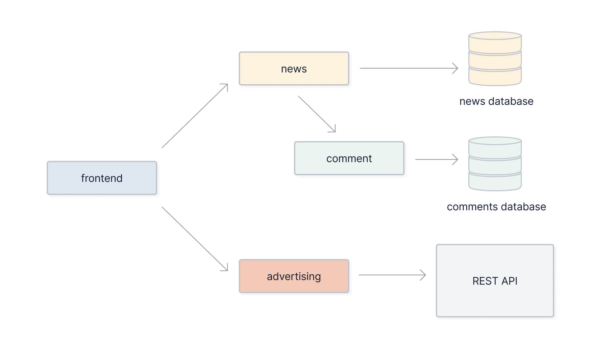
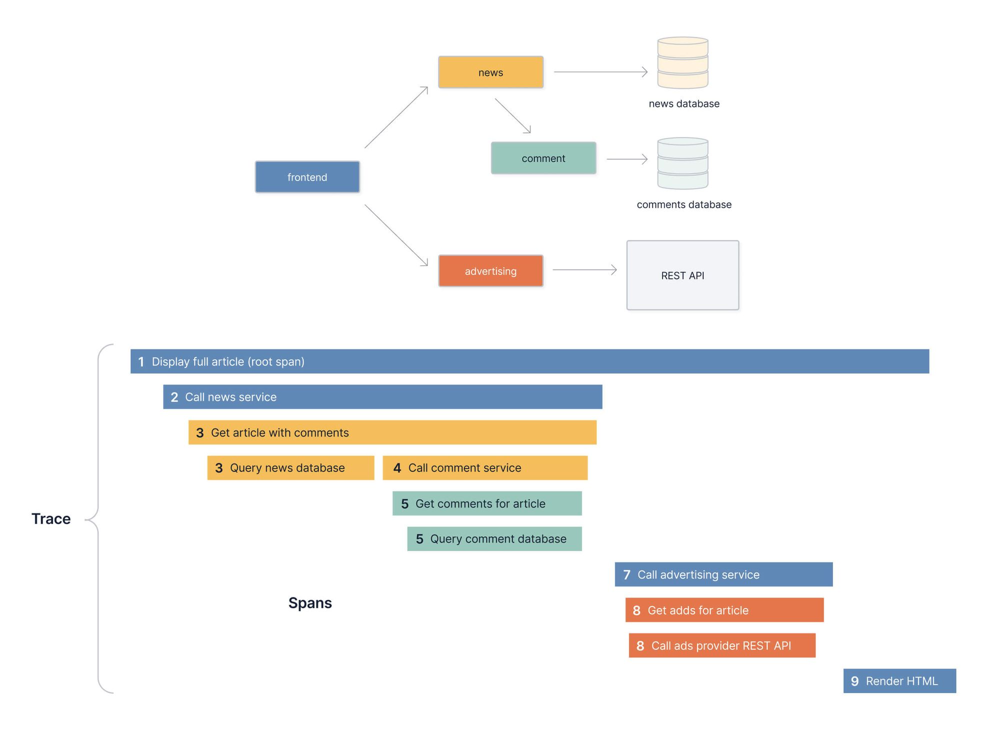
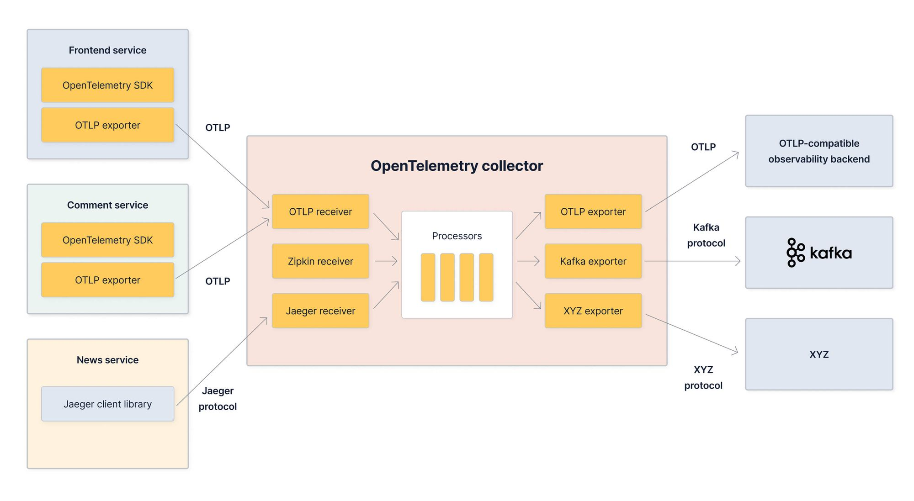
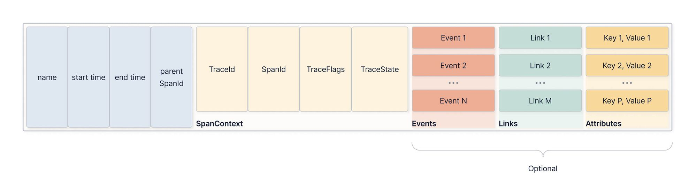

Developing software is hard. Debugging complex software systems is often harder. When our software systems are not healthy, we need ways to quickly identify what is happening, and then dig deeper to understand why it is happening (and then fix the underlying issues). But in modern architectures based on microservices, Kubernetes and cloud, identifying problems (let alone predicting them) has become more and more difficult.

Enter observability, built on the collection of telemetry from modern software systems. This telemetry typically comes in the form of three signals: metrics, logs, and traces.

Metrics and logs are well known and have been widely adopted for many years through tools like [Nagios](https://www.nagios.org/), [Prometheus](https://prometheus.io/), or the [ELK](https://www.elastic.co/what-is/elk-stack) stack.

Traces, on the other hand, are relatively new and have seen much lower adoption. Why? Because, for most engineers, tracing is still a relatively new concept. Because getting started takes a lot of manual instrumentation work. And because, once we have done that work, [getting value out of trace data](https://danluu.com/tracing-analytics/) is hard (for example, most tracing tools today just provide the ability to look up a trace by ID or apply very simple filtering like Jaeger or Grafana Tempo).

However, traces are key to understanding the behavior of and troubleshooting modern architectures.

Here we demystify traces and explain what they are and why they are useful, using a concrete example. Then we describe OpenTelemetry and explain how it vastly simplifies the manual instrumentation work required to generate traces.

## What Is a Trace?

A “trace” represents how an individual request flows through the various microservices in a distributed system. A “span” is the fundamental building block of a trace, representing a single operation. In other words, a trace is a collection of underlying spans.

Let’s look at a specific example to illustrate the concept.

Imagine that we have a news site that is made of four micro-services:

- The<strong> <em>frontend</em> service</strong>, which serves the website to our customer’s browser.
- The<strong> <em>news</em> service</strong>, which provides the list of articles from our news database that is populated by the editorial system (and has the ability to search articles and get individual articles together with their comments).
- The<strong> <em>comment</em> service</strong>, which lets you save new comments in the comment database and retrieve all comments for an article.
- The<strong> <em>advertising</em> service</strong>, which returns a list of ads to display from a third-party provider.

<em>An architecture diagram for an example news site made up of four microservices: a frontend service, a news service, a comment service, and an advertising service.</em>

When a user clicks on the link to view an article on her browser this is what happens:

1) The <em>frontend</em> service receives the request.

2) The <em>frontend</em> service calls the <em>news</em> service passing the identifier for the article.

3) The <em>news</em> service calls the news database to retrieve the article.

4) The <em>news</em> service calls the <em>comment</em> service to retrieve the comments for the article.

5) The <em>comment</em> service calls the comment database and runs a query to retrieve all comments for the article.

6) The <em>news</em> service gets all comments for the article and sends the article and the comments back to the <em>frontend</em> service.

7) The <em>frontend</em> service calls the <em>advertising</em> service passing the contents of the article.

8) The <em>advertising</em> service makes a REST API request to the third-party ads provider with the contents of the article to retrieve the list of optimized ads to display.

9) The <em>frontend</em> service builds the HTML page, including the news, the comments, and the ads send the response back to the user’s browser.

When adding trace instrumentation to each of those services, you generate spans for each operation in the execution of the request outlined above (and more if you want more detailed tracking). This would result in a hierarchy of spans shown in the diagram below:

<em>Hierarchy of spans for the news site microservice architecture. The length of each span indicates its duration.</em>

The entry point for the request is the <em>frontend</em> service. The first span the <em>frontend</em> service emits covers the entire execution of the request. That span is called the root span. All other spans are descendants of that root span. The length of each span indicates its duration.

### What do traces show?

As you can see from the diagram above, there are two key pieces of information we can extract from a trace:

1. A connected representation of all the steps to process individual requests very easily allows us to zero in on the service and operation, causing issues in your system when troubleshooting a production problem.
2. The dependencies between different components in the system, which we could use to build a map of how those components connect to each other. In a large system with tens or hundreds of components it is important to explore and understand the topology of the system to identify problems and improvements.

### Faster troubleshooting with traces

Let’s see through a practical example of how traces help identify problems in your applications faster.

Continuing with our example, imagine that less than 1% of the REST API requests to the ads provider are suffering from slow response time (30 seconds). But those requests always come from the same set of users who are complaining to your support team and on Twitter.

We look into the problem but aggregate percentile metrics (see our blog post on [percentile metrics](https://www.tigerdata.com/blog/how-percentile-approximation-works-and-why-its-more-useful-than-averages/) to learn how to use them) are not indicating any problem because overall performance (99th percentile of response time, p99 for short) is great since this only impacts a small number of requests.

Then, we start looking into our logs, but that’s a daunting task. We have to look at logs for each individual service, and concurrent requests make it very hard to read and connect those logs to identify the problem.

<strong>What we need is to reconstruct requests around the time users reported the issue, find the slow requests, and then determine where that slowness happened.</strong>

We have to do that manually with logs, which would take hours on a high-traffic site.

With traces, we can do that automatically and quickly identify where the problem is.

One simple way to do it is to search for the slowest traces, that is, the top ten root spans with the highest duration during the time the users complained, and look at what’s consuming most of the execution time.

In our example, by looking at the visual trace representation we would very quickly see that what’s common in the slowest traces is that the request to the ads provider REST API is taking too long. An even better way (if your tracing system allows for that) would be to run a query to retrieve the slowest spans in the execution path of the slowest traces which would return the spans tracking the REST API calls.

Note that looking at the p99 response time of those REST API calls would not have revealed any problem either because the problem occurred in less than 1 % of those requests.

We’ve quickly narrowed down where the problem is and can start looking for a solution as well as inform the ads provider of the issue so they can investigate it.

One quick fix could be to put in place a one-second timeout in the API request so that a problem with the ads provider doesn’t impact your users. Another more sophisticated solution could be to make ads rendering an asynchronous call so it doesn’t impact rendering the article.

### Traces help us proactively make software better

We can also use traces to proactively make our software better. For example, we could search for the slowest spans that represent database requests to identify queries to optimize. We could search for requests (i.e., traces) that involve a high number of services, many database calls, or too many external service calls and look for ways to optimize them and/or simplify the architecture of the system.

## Traces in OpenTelemetry

[OpenTelemetry](https://opentelemetry.io/) is a vendor-agnostic emerging standard to instrument and collect traces (and also metrics and logs!) that can then be sent to and analyzed in any OpenTelemetry compatible backend. It has recently been [accepted as a CNCF incubating project](https://www.cncf.io/blog/2021/08/26/opentelemetry-becomes-a-cncf-incubating-project/), and it has a lot of momentum: it’s [the second most active CNCF project](https://all.devstats.cncf.io/d/74/contributions-chart?orgId=1), only after Kubernetes, with contributions from [all major observability vendors, cloud providers, and many end users](https://opentelemetry.devstats.cncf.io/d/5/companies-table?orgId=1&var-period_name=Last%20year&var-metric=contributions) (including Timescale).

OpenTelemetry includes a number of core components:

- <strong>API specification</strong>: Defines how to produce telemetry data in the form of traces, metrics, and logs.
- <strong>Semantic conventions</strong>: Defines a set of recommendations to standardize the information to include in the telemetry (for example attributes like the status code of a span representing an http request) and ensure better compatibility between systems.
- <strong>OpenTelemetry protocol (OTLP)</strong>: Defines a standard encoding, transport, and delivery mechanism of telemetry data between the different components of an observability stack: telemetry sources, collectors, backends, etc.
- <strong>SDKs</strong>: Language-specific implementations of the OpenTelemetry API with additional capabilities like processing and exporting for traces, metrics, and logs.
- <strong>Instrumentation libraries</strong>: Language-specific libraries that provide instrumentation for other libraries. All instrumentation libraries support manual instrumentation and several offer automatic instrumentation through byte-code injection.
- <strong>Collector</strong>: This component provides the ability to receive telemetry from a wide variety of sources and formats, process it and export it to a number of different backends. It eliminates the need to manage multiple agents and collectors.

<em>An architecture diagram illustrating the core components of the OpenTelemetry collector, the inputs it accepts, and possible outputs it can produce.</em>

To collect traces from our code with OpenTelemetry we will use the SDKs and instrumentation libraries for the language your services are written in. Instrumentation libraries make OpenTelemetry easy to adopt because they can auto-instrument (yes, auto-instrument!) our code for services written in languages that allow for injecting instrumentation at runtime, like Java and Node.js.

For example, the OpenTelemetry Java instrumentation library automatically collects traces from a [large number of libraries and frameworks](https://github.com/open-telemetry/opentelemetry-java-instrumentation/blob/main/docs/supported-libraries.md#libraries--frameworks). For languages where that is not possible (like Go) we also get libraries that simplify the instrumentation but require more changes to the code.

Even more, developers of libraries and components are already adding OpenTelemetry instrumentation directly in their code. Two examples of that are [Kubernetes](https://kubernetes.io/docs/concepts/cluster-administration/system-traces/) and [GraphQL Apollo Server](https://www.apollographql.com/docs/federation/opentelemetry/).

Once our code is instrumented we have to configure the SDK to export the data to an observability backend. While we can send the data directly from our application to a backend, it is more common to send the data to the OpenTelemetry Collector and then have it send the data to one or multiple backends.

This way, you can simplify the management and configuration of where you want to send the data and have the possibility to do additional processing (downsampling, dropping, transforming data) before it is sent to another system for analysis.

### Anatomy of an OpenTelemetry trace

The [OpenTelemetry tracing specification](https://github.com/open-telemetry/opentelemetry-specification/blob/main/specification/overview.md#tracing-signal) defines the data model for a trace. Technically, a trace is a [directed acyclic graph](https://en.wikipedia.org/wiki/Directed_acyclic_graph) of Spans with parent-child relationships.

Traces must include an operation name, start and finish timestamps, a parent Span identifier, and the SpanContext. The SpanContext contains the TraceId, the SpanID, TraceFlags, and the Tracestate. Optionally, Spans can also have a list of Events, Links to other related Spans, and a set of Attributes (key-value pairs).

Events are typically used to add to a Span one-time events like errors (error message, stack trace, and error code) or log lines that were recorded during the span execution. Links are less common but allow OpenTelemetry to support special scenarios like relating spans that are included in a batch operation with the batch operation span, which would be initiated by multiple parents (i.e., all the individual spans that add elements to the batch).

Attributes can contain any key-value pair. [Trace semantic conventions](https://github.com/open-telemetry/opentelemetry-specification/blob/main/specification/trace/semantic_conventions/README.md) define some mandatory and optional attributes to help with interoperability. For example, a span representing the client or server of an [HTTP request](https://github.com/open-telemetry/opentelemetry-specification/blob/main/specification/trace/semantic_conventions/http.md#common-attributes) must have an http.method attribute and may have http.url and http.host attributes.

<em>Data model of an OpenTelemetry Span</em>

## Conclusion

Traces are extremely useful to troubleshoot and understand modern distributed systems. They help us answer questions that are impossible or very hard to answer with just metrics and logs. Adoption of traces has been traditionally slow because trace instrumentation has required a lot of manual effort and existing observability tools have not allowed us to query the data in flexible ways to get all the value traces can provide.

OpenTelemetry is quickly becoming <em>the</em> instrumentation standard. It offers libraries that automate (or at the very least simplify) trace instrumentation, dramatically reducing the amount of effort required to instrument our services. Additionally, the instrumentation is vendor-agnostic, and the traces it generates can be sent to any compatible observability backend, so we can change backends or use multiple ones.

