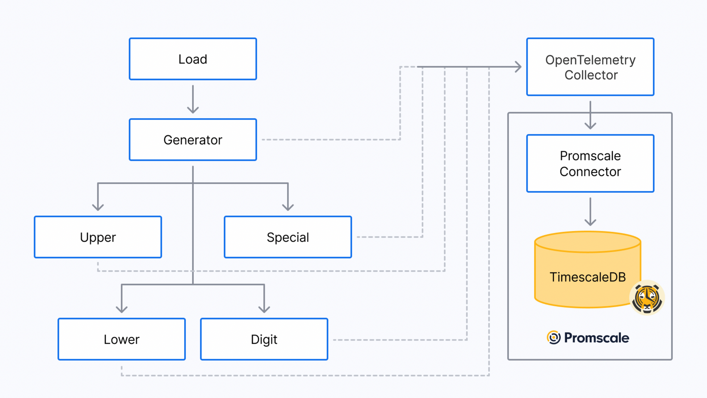
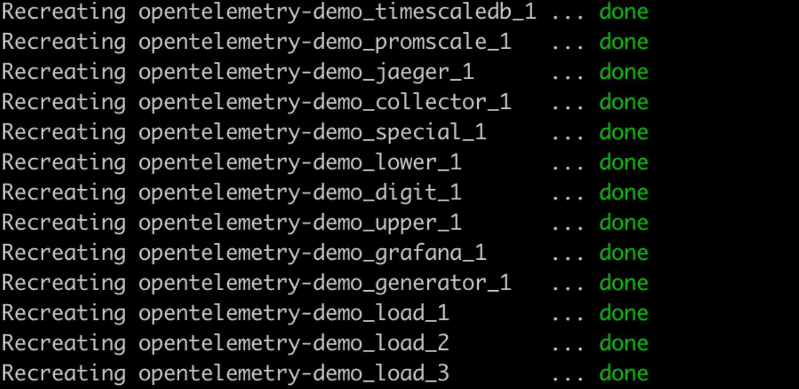
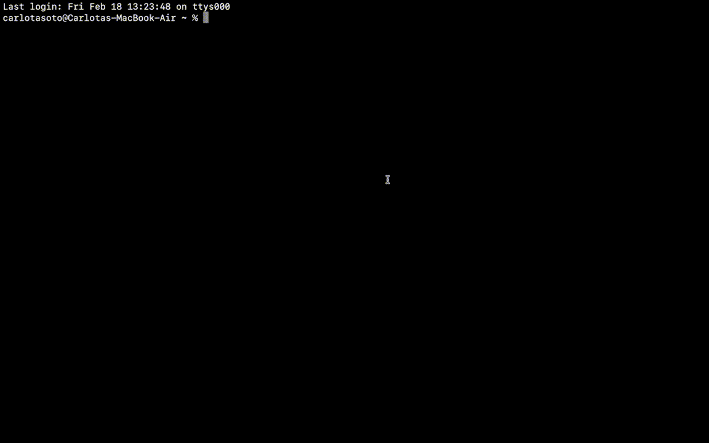
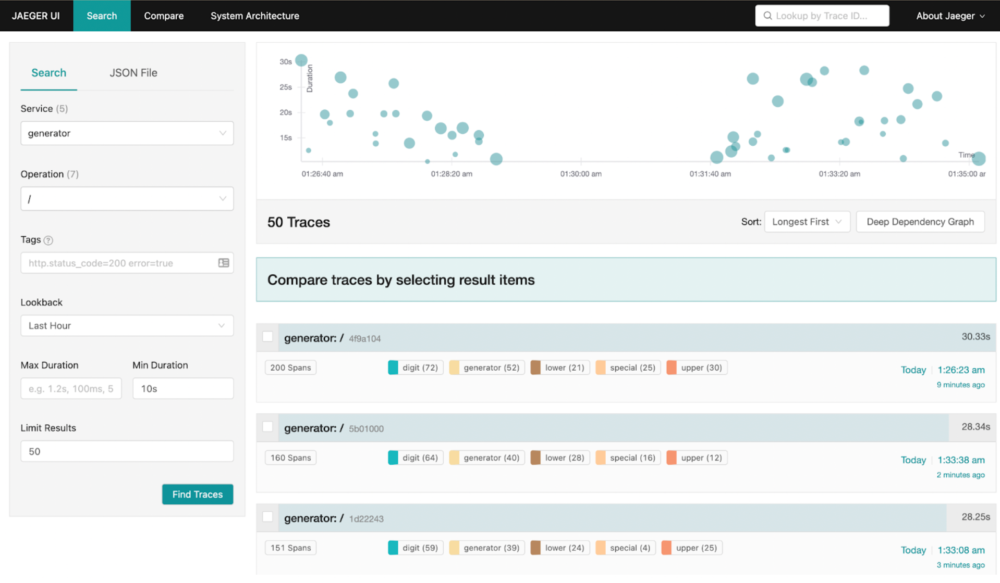
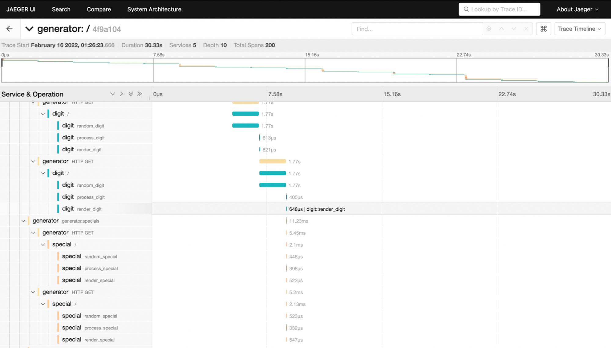
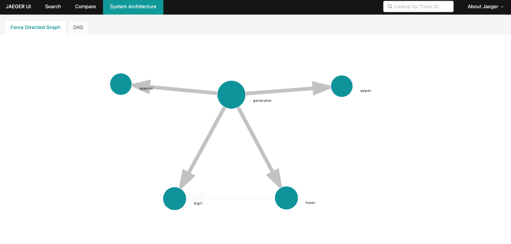

OpenTelemetry is an open-source observability framework for cloud-native service and infrastructure instrumentation hosted by the [Cloud Native Computing Foundation](https://www.cncf.io/) (CNCF). It has gained a lot of momentum with contributions from all major cloud providers (AWS, Google, Microsoft) as well as observability vendors (including Timescale) to the point it has become the second project with the [most activity](https://all.devstats.cncf.io/d/1/activity-repository-groups?orgId=1) and contributors only after Kubernetes.

A trace (or distributed trace) is a connected representation of the sequence of operations that were performed across all microservices involved in order to fulfill an individual request. Each of those operations is represented using a span. Each span includes a reference to the parent span except the first one, which is called the root span. As a result, a trace is a tree of spans. We told you everything about OpenTelemetry traces in [this blog post](https://blog.timescale.com/blog/what-are-traces-and-how-sql-yes-sql-and-opentelemetry-can-help-us-get-more-value-out-of-traces-to-build-better-software/).

However, it’s better to learn by doing. When talking about OpenTelemetry traces, we often wished we had access to a microservices demo application instrumented with OpenTelemetry, so users could play with it to directly experience the potential of tracing. For example, [in the blog post we referenced earlier](/writing/what-are-traces-and-how-to-use-them/), we used [Honeycomb’s fork of Google's microservices demo](https://github.com/honeycombio/microservices-demo), which adds OpenTelemetry instrumentation to those services. But while it is a great demo of a microservices environment, we found it too complex and resource-heavy to run it locally on a laptop for the purposes of playing with OpenTelemetry, since it requires a Kubernetes cluster with 4 cores and 4 GB of available memory.

This inspired us to build a more accessible and lightweight OpenTelemetry demo application:

[<strong>https://github.com/timescale/opentelemetry-demo/</strong>](https://github.com/timescale/opentelemetry-demo/)

In this blog post, we’ll introduce you to this demo, which consists of a password generator overdesigned as a microservices application. We’ll dive into its architecture, explain how we instrumented the code to produce OpenTelemetry traces, and how to get the demo up and running on your computer in a few minutes.

<strong>Note: </strong>This demo application is not [Promscale](https://www.tigerdata.com/blog/important-news-about-promscale/)-specific. It can be easily configured to send the telemetry it generates to any OpenTelemetry-compatible backend, and we hope the broader community will find it useful.

## Demo Architecture

The [demo application](https://github.com/timescale/opentelemetry-demo) is a password generator that has been overdesigned to run as a microservices application. It includes five microservices:

- The <strong>generator service </strong>is the entry point for requests to generate a new password. It calls all other services to create a random password.
- The <strong>upper service</strong> returns random uppercase letters (A-Z).
- The <strong>lower service</strong> returns random lowercase letters (a-z).
- The <strong>digit service</strong> returns random digits (0-9).
- The <strong>special service</strong> returns random special characters.

Apart from the microservices, the demo also deploys a pre-configured OpenTelemetry observability stack composed of the OpenTelemetry Collector, Promscale, Jaeger, and Grafana:



<em>Architecture diagram of the demo environment</em>

Obviously, this is a silly design—this is not how you would design a password generator. But we decided to use this application because it’s a very easy-to-understand example (everybody is familiar with creating secure passwords), the code is simple, and it’s very lightweight, so you can easily run it on a computer with Docker (no Kubernetes required).

To make the traces generated more interesting, the code of the services introduces random wait times and errors. There is also a bug in the code of one of the services (an Easter egg 👀 for you to find!).

All services are built in Python, except the lower service, which is built in Ruby. The demo also includes a load generator that makes requests to the generator service to create new passwords. It instantiates three instances of that load generator.

## Instrumentation

The first step to getting visibility into the performance and behaviors of the different microservices is to instrument the code with OpenTelemetry to generate traces. The five microservices included in the demo have already been instrumented; in this section, however, we'll explain how we did it, in case you’re interested in learning how to instrument your own.

OpenTelemetry provides SDKs and libraries to instrument code in a variety of different languages. SDKs allow you to manually instrument your services; at the time of this writing, the OpenTelemetry project provides SDKs for 12 (!) languages (C++, .NET, Erlang/Elixir, Go, Java, Javascript, PHP, Python, Ruby, Rust, and Swift). The maturity of those SDKs varies, though—check the [OpenTelemetry instrumentation documentation](https://opentelemetry.io/docs/instrumentation/) for more details.

Additionally, OpenTelemetry provides automatic instrumentation for many libraries in a number of languages like [Python](https://opentelemetry.io/docs/instrumentation/python/automatic/), [Ruby](https://opentelemetry.io/docs/instrumentation/ruby/automatic/), [Java](https://opentelemetry.io/docs/instrumentation/java/automatic/), [Javascript](https://opentelemetry.io/docs/instrumentation/js/getting-started/nodejs/#instrumentation-modules), or .[NET](https://opentelemetry.io/docs/instrumentation/net/automatic/). Automatic instrumentation typically works through library hooks or monkey-patching library code. This helps you get a lot of visibility into your code with very little work, dramatically reducing the amount of effort required to start using distributed tracing to improve your applications.

For services written in Python, you could leverage auto-instrumentation and not have to touch a single line of code. For example, for the generator service and after setting the `OTEL_EXPORTER_OTLP_ENDPOINT` environment variable to the URL of the OTLP endpoint (the OpenTelemetry Collector, for example) where you want data to be sent, you would run the following command to auto-instrument the service:

```
opentelemetry-instrument --traces_exporter otlp python generator.py
```

As we just mentioned, we already instrumented the code of the different microservices in our password generator demo. In our case, we decided to manually instrument the code to show how it is done and add some extra instrumentation, but that is not required.

To instrument the Python services, first, we imported a number of OpenTelemetry libraries:

```
from opentelemetry import trace
from opentelemetry.trace import StatusCode, Status
from opentelemetry.instrumentation.flask import FlaskInstrumentor
from opentelemetry.instrumentation.requests import RequestsInstrumentor
from opentelemetry.sdk.resources import Resource
from opentelemetry.sdk.trace import TracerProvider
from opentelemetry.sdk.trace.export import BatchSpanProcessor
from opentelemetry.exporter.otlp.proto.grpc.trace_exporter import OTLPSpanExporter

```

Then, we initialized and set up the tracing instrumentation for the service, including setting up the Flask and HTTP auto-instrumentation:

```
trace.set_tracer_provider(TracerProvider(resource=Resource.create({"service.name": "generator"})))
span_exporter = OTLPSpanExporter(endpoint="collector:4317")
trace.get_tracer_provider().add_span_processor(BatchSpanProcessor(span_exporter))
FlaskInstrumentor().instrument_app(app)
RequestsInstrumentor().instrument()
tracer = trace.get_tracer(__name__)
```

And finally, we added some manual spans with `tracer.start_as_current_span(name)` for each operation, and some events with `span.add_event(name)`:

```
def uppers() -> Iterable[str]:
    with tracer.start_as_current_span("generator.uppers") as span:
        x = []
        for i in range(random.randint(0, 3)):
            span.add_event(f"iteration_{i}", {'iteration': i})
            try:
                response = requests.get("http://upper:5000/")
                c = response.json()['char']
            except Exception as e:
                e = Exception(f"FAILED to fetch a upper char")
                span.record_exception(e)
                span.set_status(Status(StatusCode.ERROR, str(e)))
                raise e
            x.append(c)
        return x

```

Check the code of the [generator](https://github.com/timescale/opentelemetry-demo/blob/main/generator/generator.py), [upper](https://github.com/timescale/opentelemetry-demo/blob/main/upper/upper.py), [digit](https://github.com/timescale/opentelemetry-demo/blob/main/digit/digit.py), or [special](https://github.com/timescale/opentelemetry-demo/blob/main/special/special.py) services for complete examples.

For the Ruby service, we did something similar. Check [the code of the lower service](https://github.com/timescale/opentelemetry-demo/blob/main/lower/lower.rb) for more details!

### Running the demo

The demo uses `docker-compose` to get all components up and running on your computer. Therefore, before running it, you first need to install the [Docker Engine](https://docs.docker.com/engine/install/) and [Docker Compose](https://docs.docker.com/compose/install/) as prerequisites. We’ve tested the demo on recent versions of MacOS (both Intel and M1 processors), Linux (tested on Ubuntu), and Windows.

The [opentelemetry-demo GitHub repo](https://github.com/timescale/opentelemetry-demo) has everything you need to run the demo. First, clone the repo:

```
git clone https://github.com/timescale/opentelemetry-demo.git
```

Or, if you prefer, just [download it](https://github.com/timescale/opentelemetry-demo/archive/refs/heads/main.zip) and unzip it.

Next, go into the opentelemetry-demo folder (or opentelemetry-demo-main if you used the download option):

```
cd opentelemetry-demo
```

And run:

```
docker-compose up --detach
```

<em><strong>Note:</strong> On Linux systems, the default installation only gives the root user permissions to connect to the Docker Engine, and the previous command would throw permission errors. Running sudo docker-compose up --detach would fix the permissions problems by running the command as root but you may want to </em>[<em>grant your user account permission to manage Docker</em>](https://docs.docker.com/engine/install/linux-postinstall/#manage-docker-as-a-non-root-user)<em>.</em>

This will execute the instructions in the [docker-compose.yaml](https://github.com/timescale/opentelemetry-demo/blob/main/docker-compose.yaml) file, which will build a Docker image for each service. This could take a few minutes. Then, run all the different components of the demo environment. When `docker-compose` completes, you should see something like the following:



<em><em><em>Once the microservices demo installation is complete, you will see this output from docker-compose.</em></em></em>

And that’s it. Congratulations! You have a microservices application instrumented with OpenTelemetry sending traces to an OpenTelemetry observability stack.



<em><em><em>Installing the microservices demo with docker-compose.</em></em></em>

If at any point you want to stop the demo, just run `docker-compose down`.

We'll talk about Jaeger and Grafana extensively in the next sections of this blog post, but as a quick note—Jaeger runs on [http://localhost:16686/](http://localhost:16686/) and Grafana on [http://localhost:3000/](http://localhost:3000/) . Grafana will require credentials to log in for the first time: use `admin` for the username and also `admin` for the password. You will be able to update your password immediately after.

## Visualize individual traces with Jaeger

Now that you have the entire demo up, including the password generator microservices and the preconfigured OpenTelemetry observability stack, you are ready to start playing around with the generated traces.

As we explained earlier, traces represent a sequence of operations, typically across multiple services, that are executed in order to fulfill a request. Each operation corresponds to a span in the trace. Traces follow a tree-like structure, and thus most tools for visualizing traces offer a tree view of all the spans that make up a trace.

Jaeger is the most well-known open-source tool for visualizing individual traces. Actually, Jaeger is more than just visualization, as it also provides libraries to instrument code with traces (which [will be deprecated soon in favor of OpenTelemetry](https://medium.com/jaegertracing/migrating-from-jaeger-client-to-opentelemetry-sdk-bd337d796759)), a backend service to ingest those traces, and in-memory and local disk storage. Jaeger also provides a plugin mechanism and a gRPC API for integrating with external storage systems.

Jaeger is particularly helpful when you know your system is having a problem and you have enough information to narrow down the search to a specific set of requests. For example, if you know that some users of your application are experiencing very slow performance when making requests to a specific API, you could run a search for requests to that API that have taken more than X seconds and, from there, visualize several individual traces to find a pattern of which service and operation is the bottleneck.

Let’s turn to our simple demo application to show an example of this. If you have the demo application running, [you can access Jaeger here.](http://localhost:16686/search)

Now, let’s say we know there are some requests to generate a password that are taking more than 10 seconds. To find the problematic requests, we could [filter traces in Jaeger to the generator service that have taken more than 10 seconds](http://localhost:16686/search?end=1644971490615000&limit=20&lookback=1h&maxDuration&minDuration=10s&operation=%2F&service=generator&start=1644967890615000) and sort them by “Longest First”:



<em><em><em>Jaeger search UI (if you have the microservices demo running, </em></em>[<em><em>you can access Jaeger here</em></em>](http://localhost:16686/search)<em><em>).</em></em></em>

In our case, we are seeing a request with 200 spans taking more than 30 seconds. Let’s open that trace and see why it is taking so long:



<em><em><em>Visualizing a distributed trace in Jaeger (if you have the microservices demo running, </em></em>[<em><em>you can access Jaeger here</em></em>](http://localhost:16686/search)<em><em>).</em></em></em>

After inspecting it carefully, we can see that the `random_digit` operation in the digit service is taking more than 1 second every time it runs, while other operations are usually run in a few microseconds or milliseconds. If we go back to the list of traces, and open another slow trace, we will see that it points again to the same problem.

With that information, we can now inspect the code of the `random_digit` operation in the digit service, which reveals the problem:

```
def random_digit() -> str:
    with tracer.start_as_current_span("random_digit") as span:
        work(0.0003, 0.0001)

        # slowness varies with the minute of the hour
        time.sleep(sin(time.localtime().tm_min) + 1.0)

        c = random.choice(string.digits)
        span.set_attribute('char', c)
        return c

```

Now we can see why this operation is giving us trouble: it's because the code is calling the `time.sleep` function, which is slowing it down!

Besides trace visualization, Jaeger also provides [a service map](http://localhost:16686/dependencies) of your microservices architecture generated from trace data. This is useful to get an overview of service dependencies, which can help identify unexpected dependencies and also ways to simplify or optimize the architecture of your application. For example, the map below shows us how the generator service calls all the other services:



<em><em><em>Service map view in Jaeger (if you have the microservices demo running, </em></em>[<em><em>you can access Jaeger here</em></em>](http://localhost:16686/search)<em><em>).</em></em></em>

## Summary

With this lightweight OpenTelemetry demo, you can get an easy-to-deploy microservices environment with a complete OpenTelemetry observability stack running on your computer in just a few minutes.

This will help you get started with distributed tracing visualization tools like Jaeger, which are easy to use and let you dig into specific traces to troubleshoot a problem if you know what you are looking for.

