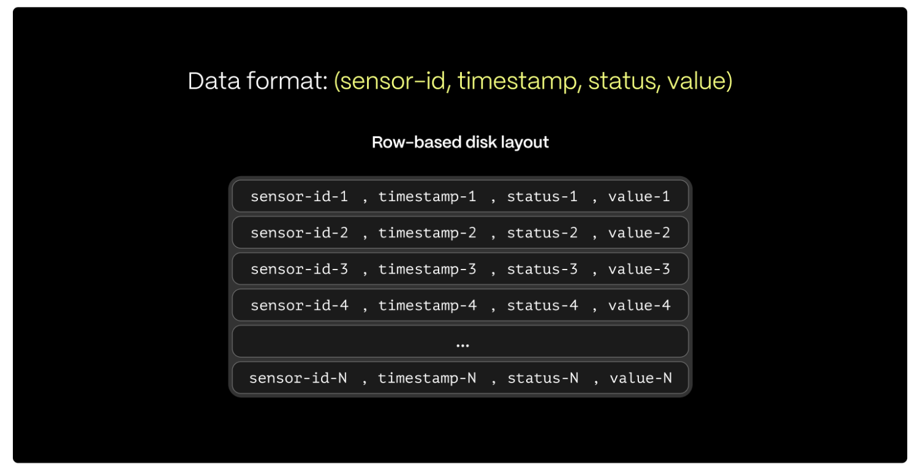
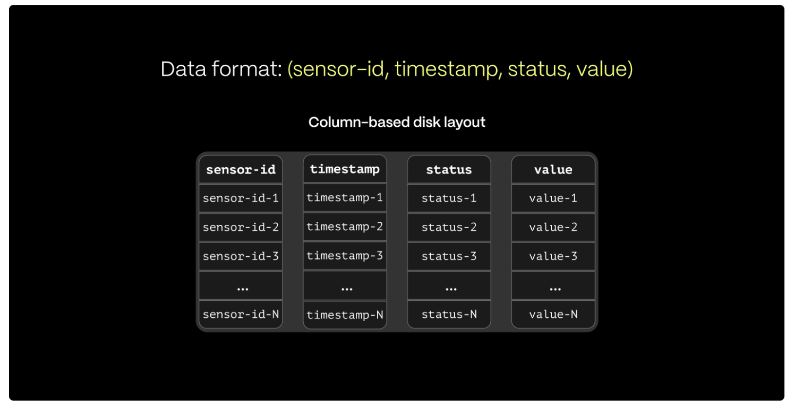
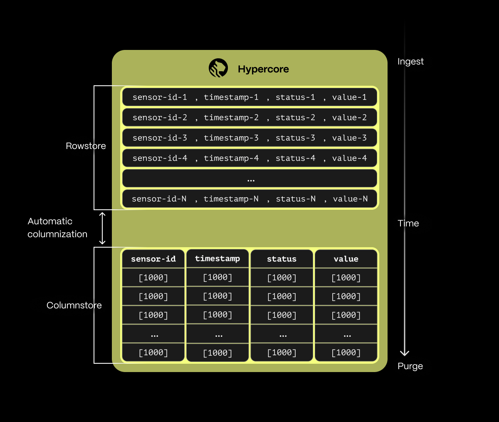

There is no arguing that Postgres has grown up over the last two decades. From a [little-known academic project](https://www.postgresql.org/docs/current/history.html#HISTORY-BERKELEY) to the [most loved database two years running](https://survey.stackoverflow.co/2024/technology#most-popular-technologies-database), Postgres has evolved into a versatile, polyglot platform with extensions to cover nearly every use case. As developer choices become increasingly complex, using [Postgres for everything](https://www.tigerdata.com/blog/postgres-for-everything/) allows you to [collapse your data stack](https://www.tigerdata.com/blog/how-to-collapse-your-stack-using-postgresql-for-everything/), simplifying your architecture and making your life easier.

At Timescale, our goal is simple: to make Postgres even better. [We’ve empowered hundreds of thousands of developers across industries](https://www.tigerdata.com/blog/tag/dev-q-a/)—including IoT, crypto, finance, developer tools, SaaS, and more—to use Postgres for their most critical applications. Companies like Toyota rely on TimescaleDB to monitor NASCAR racing cars, Postman uses it to power their API analytics, and OVHCloud has built its billing engine on TimescaleDB. Like many others, these companies need more than just a database—they need one that can handle high-performance workloads.

In any application, relational data like user accounts, permissions, and payment information needs to be stored and managed efficiently, and Postgres handles these tasks exceptionally well. But today’s applications often need more than just transactional consistency. They require the ability to make fast, precise decisions using large amounts of up-to-the-second data, often in mission-critical scenarios.

We have traditionally thought of these as time-series problems, and while time-series data is certainly central, we’ve come to realize that for users, it’s almost an implementation detail. The real challenge our customers' applications are solving is real-time analytics. This is where TimescaleDB shines, empowering developers to address both their relational and real-time analytics needs within the database they already know and trust: Postgres. And it achieves this thanks to its hybrid row-columnar storage engine—an automatic, efficient, and finely engineered mechanism we’re calling <strong>hypercore</strong>.

## Is Your Use Case Real-Time Analytics?

The problem with real-time analytics is challenging to solve. Real-time analytics involves processing and analyzing data as it’s created, providing immediate insights so you can act on that data without delay. It’s not just about knowing what’s happened in the past; it’s about understanding what’s happening <em>right now</em>.

Whether you're tracking stock prices, monitoring IoT sensor data, or analyzing user behavior, the goal is to make decisions in the moment by combining live data with historical context. These insights are often delivered through embedded dashboards or driving decision engines within customer-facing applications, demanding millisecond query response times.

To achieve this level of responsiveness, real-time analytics needs a database that supports:

- <strong>High ingest throughput:</strong> supporting sustained high insert rates, often in the hundreds of thousands of writes per second, typically through streaming ingest
- <strong>Low-latency ingestion:</strong> ensuring that new data is immediately available for queries
- <strong>High query performance:</strong> executing fast, targeted queries on recent data with low-latency responses for time-sensitive analytics
- <strong>Data updates and late-arriving data:</strong> allowing updates and late data to be added immediately, which happens in many real-world scenarios
- <strong>Efficient data management:</strong> making use of techniques like compression, rollups, or retention policies to improve query performance and control costs as data accumulates

Now, compare this to general-purpose analytics, where large datasets are typically processed in batches, and timeliness isn’t as critical. With batch analytics, you can afford delays in data updates and query results because you’re working with historical data over longer periods. In these cases, near-instant updates and low-latency querying aren’t as crucial, and systems can tolerate delays.

But with real-time analytics, every second counts—both for ingesting new information and making that data immediately available for querying. This is where TimescaleDB excels.

TimescaleDB can meet the demands of real-time analytics due to its hybrid row-columnar storage engine: <strong>hypercore</strong>. This engine allows TimescaleDB to automatically handle both the high-speed ingestion of new data and the efficient querying of large datasets, all while maintaining the flexibility and performance required for real-time workloads.

## Hypercore: A Hybrid Row-Columnar Storage Engine for Postgres

A bit of honesty up front: hypercore isn’t a new thing, it already powers our highly [performant compression](https://www.tigerdata.com/blog/building-columnar-compression-in-a-row-oriented-database/). At the same time we realized some of our customers were more aligned with real-time analytics than [time series](https://www.tigerdata.com/blog/time-series-introduction), we also recognized that compression wasn’t the killer feature for them. What mattered was the conversion from row-oriented to column-oriented which came with compression. So, we recently renamed the whole package as hypercore.

Hypercore is built to handle the unique challenges of real-time analytics in a way that’s both powerful and easy to use. Rather than forcing developers to choose between a transactional ([OLTP](https://www.tigerdata.com/learn/understanding-oltp)) database and an analytics (OLAP) database, hypercore combines the best of both worlds. It blends row-oriented and column-oriented storage formats into one system, creating a hybrid storage engine that seamlessly and automatically shifts data between the two based on how it’s used.

Let’s take a look at row and column-oriented storage formats and how they differ.

### Row-oriented storage vs. columnar-oriented storage

In a [row-oriented storage format](https://www.timescale.com/learn/columnar-databases-vs-row-oriented-databases-which-to-choose), data is stored sequentially by rows, meaning all the fields of a record are kept together on disk. This makes it highly efficient for transactional workloads, where operations involve reading or writing entire records, like inserting new readings or retrieving a reading by ID.

Row-based storage supports [ACID transactions](https://www.timescale.com/learn/understanding-acid-compliance) by allowing easy access, locking, and modification of entire rows, ensuring both consistency and efficient execution. However, it is less than ideal for analytical queries focusing on specific columns. Since entire rows must be read to retrieve a single column, it leads to high I/O costs and slower query performance.

<em>How data is stored in a row-based layout</em>

In contrast, a [column-oriented storage format](https://www.timescale.com/learn/columnar-databases-vs-row-oriented-databases-which-to-choose) stores data by individual columns instead of rows, greatly improving performance for analytical queries. This structure allows the database to efficiently read only the relevant columns needed for a query, avoiding unnecessary data retrieval.

[Columnar storage](https://www.tigerdata.com/blog/building-columnar-compression-in-a-row-oriented-database) is particularly efficient for aggregate operations like counting, averaging, or summing values, as each column can be scanned sequentially, resulting in faster queries. Another advantage is that columnar storage enables high compression rates. Since each column contains similar data types, [compression algorithms](https://www.tigerdata.com/blog/time-series-compression-algorithms-explained) can more easily identify patterns and redundancies.

<em>How data is stored in a column-based layout</em>

However, columnar storage struggles with workloads that involve reading or writing full rows, real-time inserts, and frequent updates. These operations require multiple columns to be accessed, compressed, or decompressed simultaneously, leading to increased I/O overhead and slower performance for these tasks.

As a developer, you want fast inserts <em>and</em> efficient analytics—that’s why we built hypercore, combining the strengths of row and column storage into one unified engine.

Here’s how hypercore's hybrid approach combines the benefits of both formats:

<em>Hypercore's hybrid approach: data is written to a rowstore and then automatically migrated to a columnstore, allowing fast ingest rates and powerful analytics without developer intervention or storage overhead</em>

- <strong>Fast ingest with rowstore:</strong> New data is initially written to a rowstore optimized for high-speed inserts and updates. This process ensures that real-time applications can handle rapid streams of incoming data while also allowing for mutability—upserts, updates, and deletes happen seamlessly.
- <strong>Efficient analytics with columnstore:</strong> As the data "cools" and becomes more suited for analytics, it is automatically migrated to a columnstore, where it’s compressed into small batches and organized for efficient, large-scale queries. This columnar format allows for fast scanning and aggregation, optimizing performance for analytical workloads while also saving significant storage space.
- <strong>Full mutability with transactional semantics: </strong>Regardless of where data is stored, TimescaleDB provides full ACID support and ensures your inserts and updates to the rowstore and columnstore are always consistent and available to queries as soon as they are completed like in a vanilla Postgres database.

Hypercore abstracts all this complexity away from the developer. Data is ingested and stored in the most efficient format and queried transparently across the rowstore and the columnstore without needing to manually manage the transition and without the overhead of storing in both formats at the same time. This hybrid approach allows developers to maintain fast ingest rates while still enabling powerful analytics—without having to choose between the two.

## Key Capabilities of Hypercore

When we first released hypercore back in 2019, we called it simply "compression." Since then, we’ve made hundreds of incremental improvements to better serve developers building real-time analytics applications. Just this week, we announced two major performance optimizations: [the introduction of skip (sparse) indexes](https://www.timescale.com/blog/boost-postgres-performance-by-7x-with-chunk-skipping-indexes) and [inline tuple filtering during decompression](https://www.timescale.com/blog/bridging-the-gap-between-compressed-and-uncompressed-data-in-postgres) for DML operations (inserts, deletes, and updates).

Here are four key capabilities of hypercore that deliver real value to developers: chunk micro-partitions, SIMD vectorization, skip indexes, and compression.

### Chunk micro-partitions with segmentation

TimescaleDB automatically partitions your data into chunks, storing them first in the rowstore and later in the columnstore. Hypercore enhances this by allowing you to group data within a columnstore chunk by a segmentation key, effectively creating micro-partitions within each chunk. This speeds up queries that filter on the segmentation key, as hypercore can quickly narrow down to only the relevant micro-partitions, avoiding the need to uncompress the entire chunk. This optimization makes query execution faster and more efficient.

### SIMD vectorization

SIMD (Single Instruction, Multiple Data) vectorization is a powerful optimization used to accelerate data processing by enabling the CPU to process an operation on multiple data points in one instruction. We [introduced SIMD vectorization in TimescaleDB](https://www.tigerdata.com/blog/teaching-postgres-new-tricks-simd-vectorization-for-faster-analytical-queries/) in 2023 to dramatically boost performance for real-time analytics. By allowing the CPU to process multiple values at once, SIMD speeds up tasks like compression, decompression, scanning, filtering, and aggregating large datasets. Our upcoming updates have shown up to 30x faster `SELECT` queries and 10x faster `DELETE` operations compared to TimescaleDB 2.16.0, with ongoing work to further optimize more query patterns.

### Skip indexes

Skip indexes allow hypercore to accelerate queries by [skipping over irrelevant data](https://www.timescale.com/blog/boost-postgres-performance-by-7x-with-chunk-skipping-indexes). These indexes store metadata such as minimum and maximum values for each block. For example, if you're querying for orders with an ID greater than 10,000, the skip index allows the engine to bypass blocks where the maximum ID is less than or equal to 10,000. In the latest version of TimescaleDB, chunk-skipping indexes can be defined on the columnstore, enabling chunk exclusion for even faster query performance by pruning irrelevant chunks from the search. This exclusion dramatically reduces the data that needs to be processed, resulting in much faster analytical queries.

### Compression

The columnstore format is designed to group similar types of data (like timestamps or device IDs) inside our micro-partitions, enabling the use of [specialized compression algorithms](https://www.tigerdata.com/blog/time-series-compression-algorithms-explained/) tailored to each column. Hypercore automatically applies best-in-class, lossless compression algorithms when moving data from rowstore to columnstore, achieving up to 98 % compression. This doesn’t just save on storage—it also speeds up query performance by reducing I/O, as there's less data to read and process during queries.

## Conclusion

Applications that deliver real-time analytics are now essential in several industries. They need to ingest massive amounts of data and provide instant insights. And they need to do it while still managing traditional relational data, like user accounts or payments, seamlessly. That’s where TimescaleDB’s hypercore comes in—[a hybrid row-columnar storage engine finely engineered over the years](https://www.tigerdata.com/blog/building-columnar-compression-in-a-row-oriented-database/) that allows you to stick with PostgreSQL even when handling the most challenging real-time analytics use cases.

With TimescaleDB and hypercore, you get the best of both worlds: fast, transactional inserts with row-based storage and blazing-fast query performance with columnar compression for analytics. You don’t need to compromise or manage multiple databases.

Want to try hypercore today? [Download and run TimescaleDB on your machine](https://docs.timescale.com/self-hosted/latest/install/). Want to take it out for a spin while reaping the full benefits of a managed PostgreSQL platform with [automated data tiering to S3](https://www.tigerdata.com/blog/scaling-postgresql-for-cheap-introducing-tiered-storage-in-timescale/), detailed [query performance insights](https://www.tigerdata.com/blog/database-monitoring-and-query-optimization-introducing-insights-on-timescale/), an integrated SQL editor, [fast vector search](https://www.tigerdata.com/blog/pgvector-is-now-as-fast-as-pinecone-at-75-less-cost/), [one-click replicas and forks](https://www.tigerdata.com/blog/introducing-one-click-database-forking-in-timescale-cloud/), [automated backups](https://www.tigerdata.com/blog/how-high-availability-works-in-our-cloud-database/), and more? [Sign up for Timescale Cloud](https://console.cloud.timescale.com/signup) (it’s free for 30 days).

