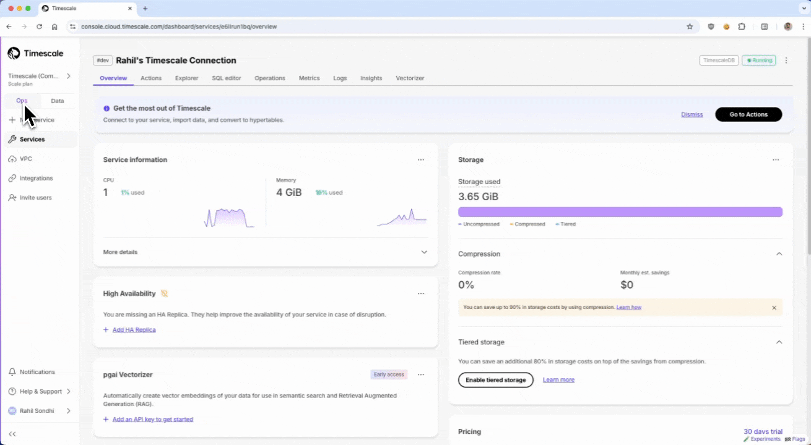
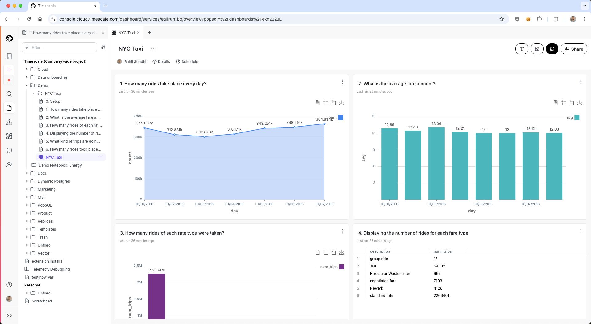
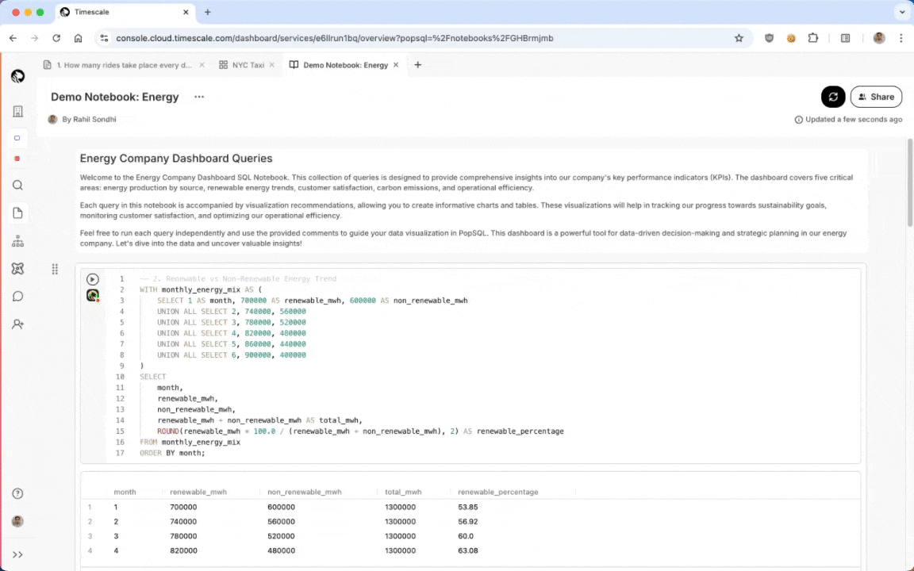
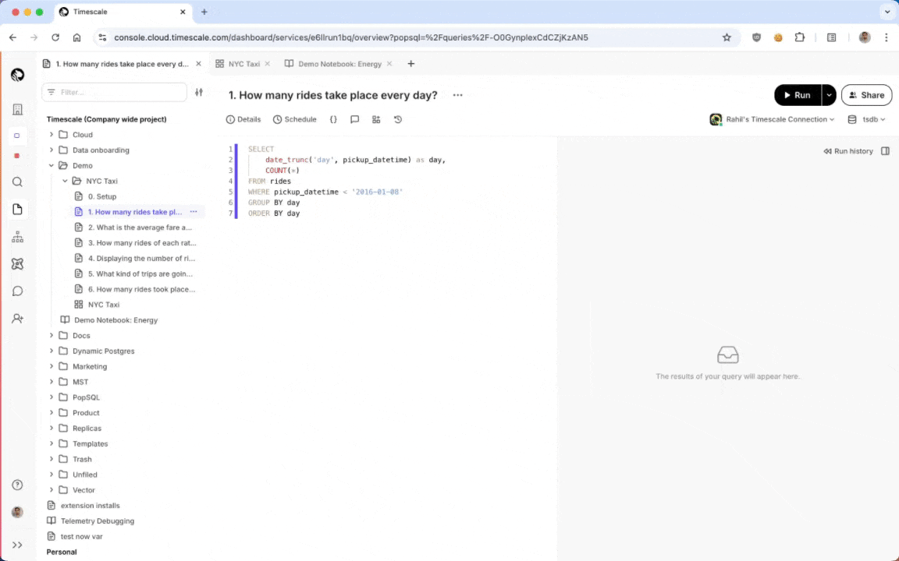
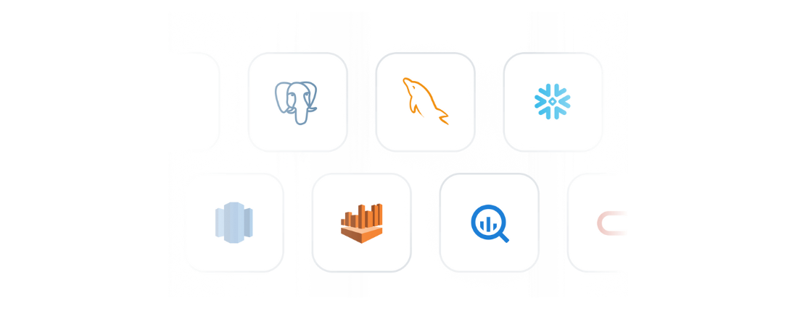

For years, developers have been using PostgreSQL for all kinds of workloads, from managing simple web app data to handling complex real-time analytics. As the demand for PostgreSQL grows, so does the need for tools that support fast, collaborative, and streamlined workflows.

However, the experience of connecting and interacting with the database has yet to fully evolve to meet this new landscape, with many developers still connecting to PostgreSQL using psql, pgAdmin, and DBeaver.

While these tools have served developers well for many years, they were not designed to meet the needs and collaborative workflows of developers building modern applications in the cloud. When you add in other tools like Grafana for visualization and GitHub for managing query versioning, it creates a fragmented, siloed workflow that slows developers down.

Earlier this year, [we acquired PopSQL](https://www.tigerdata.com/blog/best-postgresql-gui-popsql-joins-timescale/) to solve that problem and help us build the best PostgreSQL developer experience for the cloud era. Today, we are announcing a big step toward that mission: <strong>bringing the amazing capabilities PopSQL offers directly inside the Timescale Console with our new Ops and Data modes</strong>. Ops mode focuses on configuring and managing your database services, while Data mode serves as your integrated go-to solution for connecting to your database to develop your application queries, share data insights through dashboards, and help troubleshoot database issues.

With these two modes, we are making developers more productive by providing [database operations](https://www.tigerdata.com/learn/guide-to-postgresql-database-operations) and an intuitive, collaborative SQL editor that simplifies query writing, collaboration, visualization, and sharing all in one place.

We’ll dive into those features in a minute, but first, let’s take some time to understand the typical experience of developers working with PostgreSQL.✨To check this week’s previous launches and keep track of upcoming ones, [head to this blog post](https://www.timescale.com/blog/making-postgres-easier) or our [launch page](https://www.timescale.com/launch/2024).

## The Current PostgreSQL Experience: A Fragmented World

We asked PostgreSQL developers about their day-to-day tools, and here’s what they said in our <em>2023</em> <em>State of PostgreSQL</em> survey: most use [psql](https://www.tigerdata.com/blog/how-to-install-psql-on-mac-ubuntu-debian-windows/) (59.5%) to execute SQL queries, followed by pgAdmin (38%) and DBeaver (30.4%). (Stay tuned for this year’s report! If you haven’t taken this year’s survey yet, [do it](https://form.typeform.com/to/wtUFIZwA)! It’s open until October 31.)

These tools were built for individual use on local desktops, with limited support for real-time collaboration and no seamless way to share queries or visualizations across teams who rarely work all together in the same office.

`psql` offers a command-line interface that’s powerful but lacks the user-friendly features needed for quick visualization or sharing. While pgAdmin and DBeaver provide more functionality, they are still rooted in a single-user mindset, making team collaboration cumbersome. The top five includes DataGrip and IntelliJ, which are also single-user desktop tools.

To make matters worse, developers often rely on additional tools for building visualizations, like Grafana, copy-pasting into Slack to share queries or dashboards, using GitHub for query versioning, etc. This fragmented workflow is inefficient and error-prone, with constant copying and pasting across multiple tools.

Before discovering [PopSQL](https://www.tigerdata.com/blog/best-postgresql-gui-popsql-joins-timescale), this was exactly the experience we had at Timescale. We used psql for querying data, Grafana for dashboarding, and Slack for collaboration. When writing a query in psql, we collaborated by copying and pasting the SQL in Slack as we made changes, which slowed us down and introduced errors.

Putting that query in Grafana to create a dashboard meant more copying and pasting, and if that query was later updated through Slack conversations, we had to somehow ensure it was kept up to date in Grafana. Finally, finding an agreed-upon query in Slack and its change history required scanning long, buried Slack threads. It was like searching for a needle in a haystack—endless scrolling, broken context, and a lot of wasted time.

“There’s got to be a better way,” we thought. Modern cloud-based development requires a tool that not only allows for writing and running SQL but also enables easy sharing, version control, and visualization—all within a collaborative environment. Sadly, this is something traditional tools weren’t designed to offer.

Then we found [PopSQL](https://www.tigerdata.com/blog/best-postgresql-gui-popsql-joins-timescale) and fell in love with its intuitive interface, fast query editor with integrated versioning, collaboration options, powerful dashboards, and amazing sharing capabilities. We wanted to bring all of those features to our users through a single integrated web UI that combined the power of the Timescale Console with PopSQL.

## Say Hello to Ops and Data Modes: Streamlined PostgreSQL Workflows, One Click at a Time

Our new Ops and Data Modes, designed to meet the diverse needs of PostgreSQL users, are the heart of the PopSQL and Timescale Console integration.

<strong>Ops Mode</strong> is for managing and maintaining Timescale services—it’s what the Timescale Console used to be. Whether you're adding replicas, setting up continuous aggregates, or fine-tuning your database settings, Ops Mode gives you a clear, operationally focused view. This mode also leverages PopSQL’s querying capabilities to turn SQL instructions into runnable queries and offers a fast, lightweight SQL editor for running one-off queries to check database stats or troubleshoot minor issues.

<strong>Data Mode</strong> is all about unlocking the full power of PopSQL. This is where your queries come to life—you can write, visualize, share, and schedule them without ever leaving the console. Think of it as your SQL playground, where you get autocomplete for faster coding, schema exploration to navigate your database and visualizations that transform query results into beautiful, shareable charts.

Switching between modes is just one click away.

Let’s dive deeper into the new capabilities now available directly through the Timescale Console.

### Streamline SQL development and collaboration

PopSQL’s integration into the Timescale Console transforms how teams work with SQL, offering a suite of features that enhance querying, collaboration, and visualization:

- <strong>Real-time collaboration</strong>: Work together directly in the SQL editor, seeing changes instantly. Perfect for peer reviews and remote teamwork, it eliminates the need to copy-paste queries back and forth over Slack.
- <strong>Autocomplete</strong>: Write queries faster with intelligent suggestions for tables, columns, and functions as you type. This feature speeds up your workflow and reduces errors.
- <strong>Schema exploration</strong>: Easily understand your data model with a detailed view of tables and columns. Pin frequently used tables or use advanced filters to quickly navigate large schemas.
- <strong>Version history</strong>: Track every change to your queries, view differences between versions, and revert or copy as needed—making version control effortless. It supports two-way sync with your existing GitHub or GitLab repository.
- <strong>Query variables</strong>: Parameterize queries to easily adjust values like date ranges or user IDs. This makes customization safe and efficient without the need to rewrite SQL.
- <strong>Charts</strong>: Instantly visualize query results within the SQL editor to identify patterns, trends, and correlations, all without switching tools.

### Build and share dynamic SQL dashboards in minutes

Create SQL-based dashboards faster than any other tool, allowing you to deliver insights in minutes rather than weeks compared to traditional dashboarding and BI tools:

- <strong>Flexible widgets</strong>: tell your data story effectively with different visual elements like tables, charts, text blocks, images, and more.
- <strong>Dashboard filters</strong>: make dashboards dynamic by using variables and parameters like date ranges or customer IDs, making data exploration quick and personalized.
- <strong>Metadata for context</strong>: easily find relevant information with descriptions, author details, and open counts, so users know what they’re looking at and who to contact for questions.
- <strong>Scheduled refreshes</strong>: keep your dashboards current by scheduling automatic refreshes at specific intervals and pushing updated results to Slack or email.

### Tell better stories using notebooks

PopSQL Notebooks let you tell comprehensive data stories by combining queries, visualizations, and explanations all in one place. Use it to create clear, shareable narratives that make your troubleshooting and analysis easy to understand and explore.

- <strong>Markdown support</strong>: write intros, document assumptions, and state conclusions for clarity.
- <strong>Multiple queries & visualizations</strong>: add as many SQL queries, charts, and tables as needed to build your story.
- <strong>Cross-source data</strong>: join data from multiple sources like Postgres and Snowflake seamlessly.
- <strong>Reference previous queries</strong>: use the results of one query in subsequent ones for deeper analysis.

### Effortless SQL sharing and organization

PopSQL makes sharing and organizing SQL easy by creating a centralized, reusable library of peer-reviewed queries, dashboards, and notebooks, improving efficiency and collaboration across your team.

- <strong>Organized folders</strong>: store queries, dashboards, and notebooks in easily accessible folders.
- <strong>Shareable links</strong>: quickly share SQL with teammates via links; no copy-pasting or screenshots needed.
- <strong>Access control</strong>: set view and edit permissions for secure sharing across teams.
- <strong>Team-based organization</strong>: create teams for departments to effectively manage access control and collaboration.
- <strong>Searchable library</strong>: quickly find any past query, dashboard, or notebook to avoid duplicating work.

### Bring all your databases together

PopSQL is designed to work seamlessly with your Timescale database while also allowing you to connect many popular databases, all from one platform. Whether you’re working in the cloud or locally, PopSQL makes connecting to multiple data sources simple and secure.

- <strong>Centralized database access</strong>: manage your Timescale database alongside your other databases in one SQL editor, eliminating the need for multiple tools.
- <strong>Secure and flexible connections</strong>: connect securely with direct connections, SSH tunnels, SSL settings, and OAuth for a variety of databases.
- <strong>Quick onboarding</strong>: set up database connections in minutes and securely share access with teammates when needed.
- <strong>Desktop and cloud versatility</strong>: use the PopSQL desktop app for local development or VPN-protected databases, or connect through the Timescale Console for cloud access through static IPs.

## Even More Coming Soon

Bringing PopSQL into Timescale is just the beginning. Ops Mode and Data Mode are the first steps in modernizing PostgreSQL’s GUI and integrating PopSQL more deeply into the PostgreSQL ecosystem. We’re committed to delivering a cloud-native, collaborative, and scalable PostgreSQL experience that aligns with what developers like you expect today.

As workflows grow more complex and the demand for collaboration increases, we’ll keep evolving this foundation. Over the coming months, you can expect new features that will push the boundaries of what’s possible. We’re especially excited about AI-driven improvements that will take your developer experience to the next level—but we’ll keep the details under wraps for now. Stay tuned—[there’s much more to come](https://www.tigerdata.com/blog/making-postgres-easier).

If you’re a Timescale Cloud customer, Data Mode and Ops Mode are already in your console. [Try them out](https://console.cloud.timescale.com/), and I’d love to hear your thoughts. If you’re not yet a customer, [now’s a great time to get started](https://console.cloud.timescale.com/signup).

