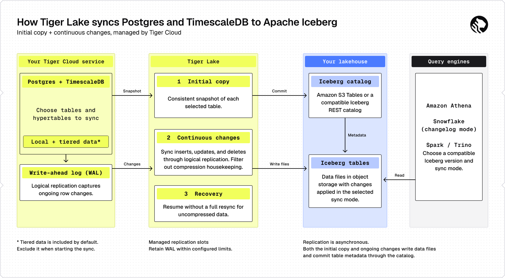
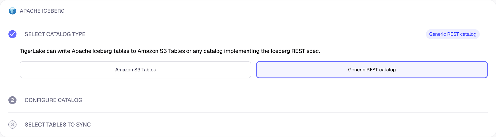
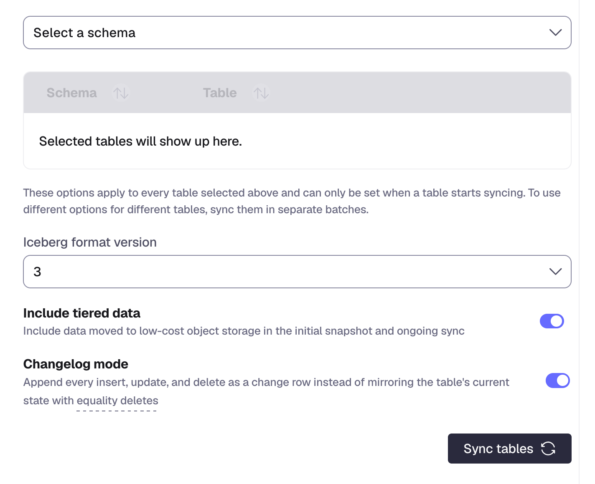
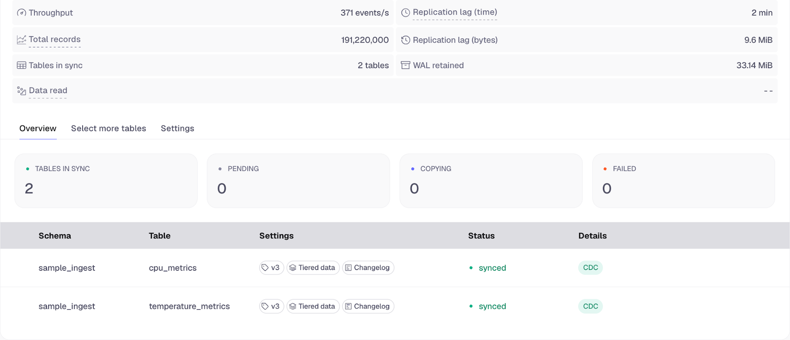

Your application writes to Postgres. Your data team works in a lakehouse. Keeping them connected often means building a pipeline and taking responsibility for it.

Today we’re making Tiger Lake generally available to all Tiger Cloud users. It continuously syncs Postgres tables and TimescaleDB hypertables into Apache Iceberg, an open table format that lets you use the same data across analytical tools. Your application keeps writing to Postgres, and your data team gets that data continuously synced into Apache Iceberg, without building and operating a separate replication pipeline.

It’s built for teams whose operational data needs to do more than power the application that collected it.

## Your operational data has more than one job

The teams we work with run applications on continuously arriving data: sensor readings, equipment telemetry, tick data, oil well telemetry, and industrial automation events. Think about an application that monitors industrial equipment. It needs to ingest readings as they arrive, update dashboards, and help an operator investigate a problem. Tiger Cloud lets you do that in Postgres, with relational and time-series data together in one database.

Those readings have value beyond the industrial application. A data analyst wants to compare equipment performance across sites over the last year. An ML engineer wants to build a predictive maintenance model by joining equipment usage and telemetry, with customer records already in Snowflake.

They’re asking for data you already have. But making it available, and keeping it accurate, often becomes another data engineering pipeline project. Someone has to copy the existing data, capture new changes, handle corrections and deletes, and notice when replication falls behind. A one-off export doesn’t solve it either. It’s out of date as soon as new readings arrive or old ones get corrected, and once the data team depends on it, someone has to keep it current.

## Split architectures make it harder

If you keep metadata in an OLTP database and time-series data in a separate time-series or real-time OLAP database, getting accurate data into the lakehouse gets harder. Time-series and OLAP databases are built to be the final destination for the data. They don’t support change data capture, so you can’t use an ETL tool to replicate every change to your lakehouse.

As a result, you are forced to write the same time-series data twice: once to the time-series database and once to the lakehouse. When one of those writes fails, you have to detect it and fix it yourself. If you miss one, the two copies no longer match.

Data fixes are harder still. Say some old sensor readings were wrong. The source no longer has them, so you can’t resend them through the ingest pipeline, and someone has to correct them directly in the time-series database. The same correction then has to be made in the lakehouse, and with dual writes there’s no reliable way to make sure both copies end up exactly the same.

Then there are schema changes. To keep both systems matching, your pipeline also has to replicate schema changes (DDL replication), which adds even more complexity on top of the dual writes.

Over time, the two copies drift apart, and the people relying on the lakehouse pay for it. Leadership sees dashboard numbers that don’t match the application and stops trusting the data. A predictive maintenance model trained on uncorrected readings misses the signs that a machine needs service, and the machine breaks down. With Tiger Cloud, metadata and time-series data live in the same Postgres database, and Tiger Lake sends every change made there, fixes and schema changes included, to your lakehouse.

## Keep building in Postgres

Our direction for Tiger Cloud is straightforward: make Postgres the best home for demanding operational workloads, and make that data accessible to the rest of your organization. You should be able to keep building your application while other teams work with the tools they already use.

Tiger Lake provides that connection.

A big reason teams choose Tiger Cloud is that they can run their application and operational analytics in one Postgres database that ensures consistent query results, performant joins between metadata and time-series data and simpler database management, security and maintenance. We want them to keep that advantage as their data becomes useful to more people across the company. That means connecting Tiger Cloud to the lakehouse your organization already uses. Your application team keeps building in Postgres, and your data team works with familiar tools. Tiger Lake keeps the two in sync.

## How Tiger Lake works

Tiger Lake writes your data to Apache Iceberg tables. We started with Iceberg because it’s the open table format most lakehouse tools already support. The tables live in your own bucket, in a standard format many query engines like Amazon Athena, Spark or Trino can read, so you aren’t tied to one warehouse vendor.

<em>Tiger Lake architecture showing initial copy and continuous replication from Tiger Cloud to Apache Iceberg.</em>

Tiger Lake copies each table once from a consistent snapshot, then streams ongoing changes from Postgres logical replication, and commits to Iceberg tables in your own bucket through Amazon S3 Tables or an Iceberg REST catalog.

Choose the tables you want to make available in your lakehouse. Tiger Lake copies their existing rows into Apache Iceberg, then continuously syncs inserts, updates, deletes and schema changes [through Postgres logical replication](https://www.tigerdata.com/docs/integrate/connectors/destination/tigerlake). It works with both regular Postgres tables and TimescaleDB hypertables, with Amazon S3 Tables or a compatible Iceberg REST catalog as the destination. The destination uses an open format, so you can choose compatible tools to query it.

<em>Tiger Console catalog selection for Amazon S3 Tables or a generic Iceberg REST catalog.</em>

Choose Amazon S3 Tables or a compatible Iceberg REST catalog as your destination.

This makes both your existing history and new operational data available for broader analysis. An equipment monitoring application keeps serving its dashboards from Tiger Cloud, while analysts explore the same readings alongside business data in the lakehouse. Updates and deletes are synced too: if a sensor sent bad readings and your team corrects them in Postgres, the corrected values replace the bad ones in Iceberg. The analyst’s report and the maintenance model use the same numbers as the application.

For [Mechademy](https://www.tigerdata.com/blog/how-mechademy-cut-hybrid-digital-twin-infrastructure-costs), that connection is helping turn operational data into a new capability for its customers.

> <em>“With Tiger Lake, we can prepare machine-learning-ready data in under four minutes. That’s helping us build new machine-learning capabilities on our platform. Getting operational data ready for machine learning was previously a major obstacle for us, and Tiger Lake’s Apache Iceberg connector to S3 Tables has been a real lifesaver that helps us build more easily now.”</em> —<em>Arjun Panchamatia, Senior Data Engineer, Mechademy</em>

There’s no pipeline to run. Tiger Cloud handles the initial copy and the ongoing sync, and sizes each connector for you. Because Tiger Lake is built into Tiger Cloud, it also understands hypertables and keeps the sync running when something goes wrong.

## Works with hypertables and the columnstore

[Hypercore](https://www.tigerdata.com/docs/learn/columnar-storage/understand-hypercore), the TimescaleDB storage engine, moves data from the rowstore to the columnstore and compresses it as it ages. That changes how the data is stored, not the data itself, but those moves still show up in the Postgres change stream. ETL tools would attempt to copy them to the lakehouse as if they were real changes. Tiger Lake recognizes them and skips them, so your lakehouse gets only the inserts, updates and deletes your application made, and you’re billed only for those. Data that has moved to tiered storage is synced too, so analysts get the full history.

## Recovers without copying everything again

If a destination becomes unavailable or a connector falls behind, Tiger Lake keeps the sync going. It manages replication-slot retention based on the database’s available disk space. If a slot is lost, gap filling recovers the missing changes without requiring a full copy of the table. That matters when you have months or years of operational history. Recovering a sync shouldn’t routinely mean copying all of it again.

## Query from Snowflake, Databricks, and your existing analytics tools

There are two ways to set it up, depending on the tool your team uses to query the data.

<strong>Default sync.</strong> Each Iceberg table mirrors its Postgres table, including updates and deletes. Use this with Amazon S3 Tables or a compatible REST catalog if your query engine supports Iceberg equality deletes, as [Amazon Athena](https://www.tigerdata.com/docs/integrate/connectors/destination/athena) does.

<strong>Changelog mode for Snowflake and Databricks.</strong> Snowflake and Databricks don’t support equality deletes, so for them Tiger Lake writes each insert, update and delete as a new row in a Snowflake- or Databricks-managed Iceberg table. You then apply those rows to keep an up-to-date table. In Snowflake, a stream and a task can do this. The[ Snowflake guide](https://www.tigerdata.com/docs/integrate/connectors/destination/snowflake) and[ changelog documentation](https://www.tigerdata.com/docs/integrate/connectors/destination/tigerlake#changelog-mode) walk through the setup. We’re also building a native Snowflake connector, with Databricks to follow, so you won’t need this extra step.

<em>Tiger Console table-sync settings showing Iceberg format version, tiered data, and Changelog mode enabled.</em>

Either way, your operational data ends up next to the business data already in your warehouse. An equipment manufacturer, for example, could join equipment readings from Tiger Cloud with customer and service records in Snowflake to see which conditions come before a failure.

## What’s included in the GA release

For GA, we’ve focused on giving you more destination options and making the connection easier to operate.

- <strong>More catalog options:</strong> Alongside Amazon S3 Tables in your AWS account, Tiger Lake now supports [compatible Iceberg REST catalogs](https://www.tigerdata.com/docs/get-started/news/new#generic-iceberg-rest-catalog-support-in-tiger-lake) such as Snowflake Open Catalog, Snowflake Horizon Catalog, Databricks Unity Catalog, and Apache Polaris. If your lakehouse already uses one, you can write directly to it.
- <strong>Changelog mode:</strong> Capture inserts, updates, and deletes as individual change records for downstream processing and readers that need this representation.
- <strong>Visibility into the sync:</strong> See connector health, replication lag, throughput, and per-table progress and errors in [Tiger Console](https://www.tigerdata.com/docs/get-started/news/new#iceberg-destination-connector-tiered-data-changelog-mode-and-improved-observability). You can see how the initial copy is progressing and whether ongoing changes are keeping up or falling behind. Sync metrics are also available through the [metrics exporter](https://www.tigerdata.com/docs/integrate/observability-alerting/exported-metrics#tiger-lake-metrics), so your team can monitor replication alongside the rest of its infrastructure. Track replication lag, throughput, and per-table sync status in Tiger Console.

<em>Tiger Console showing replication lag, throughput, table sync counts, and per-table status.</em>

- <strong>Replication recovery: </strong>Adaptive slot retention and gap filling lets Tiger Lake resume replication without copying the entire table again. The [Slot Keep Controller](https://www.tigerdata.com/docs/get-started/news/new#more-reliable-tiger-lake-replication-slots-with-the-slot-keep-controller) manages retention of the database log used for replication, adjusting it to available disk space. That reduces the risk of a fixed limit forcing a full resync. It runs automatically and logs its actions.
- <strong>Support for ongoing changes to your setup:</strong> You can add nullable columns without defaults to synced tables and have them propagate to Iceberg, update destination credentials in the console, and have connector restarts for updates follow your maintenance window.
- <strong>Control over historical data:</strong> New syncs include data in Tiger Cloud’s object storage tier by default. You can exclude [tiered data](https://www.tigerdata.com/docs/learn/data-lifecycle/storage/about-storage-tiers) when starting a sync.

The Tiger Cloud [changelog](https://www.tigerdata.com/docs/get-started/news/new) and [docs pages](https://www.tigerdata.com/docs/integrate/connectors/destination/tigerlake) cover these additions in more detail.

## Try Tiger Lake on Tiger Cloud

<strong>Already using Tiger Cloud?</strong> Put your operational data to work in your lakehouse. Follow the [Tiger Lake setup guide](https://www.tigerdata.com/docs/integrate/connectors/destination/tigerlake) to connect your destination and start syncing the tables your team needs.

<strong>New to Tiger Cloud?</strong> [Sign up and get <strong>$1,000 in Tiger Cloud credits</strong>](https://www.tigerdata.com/go/trial) to build with Postgres and try Tiger Lake. Credits are available to new accounts and valid for 30 days. No credit card required.

## Questions you might have

### Who can use Tiger Lake?

Tiger Lake is generally available to <em>all Tiger Cloud customers on the Scale and Enterprise plans</em>. Your service needs PostgreSQL 17.6 or later, and each synced table needs a primary key (except continuous aggregates).

### Does Tiger Lake move older data out of Postgres?

No. Tiger Lake syncs selected tables into Iceberg without removing the source data or applying an age cutoff. You manage retention in Tiger Cloud separately.

### How is Tiger Lake priced?

Tiger Lake is free until March 1, 2027 for all users. After that, you pay for the connector while it runs and for the data it delivers. In AWS US regions, the connector is $0.341 per hour. The initial copy is $0.10 per GB and ongoing changes are $0.20 per GB, measured as the uncompressed size of the data we deliver to your destination. Your Iceberg tables store that data compressed. The hourly rate varies by region; the per-GB rates are the same everywhere.

### How is delivered data measured?

We measure delivered data before compression, for the tables you choose to sync. Changes to other tables and internal database housekeeping don’t count. Re-copies we cause, and data sent again after a failure on our side, are free.

The bill reflects data delivered, rather than the size of the compressed Iceberg files.

### What should I check before starting?

Make sure the tool you’ll query with supports Apache Iceberg, and that your catalog is one Tiger Lake supports.

Decide a few settings up front: the Iceberg format version, whether to include tiered data, and whether to use changelog mode. You can’t change them later without starting a new sync. The[ Tiger Lake docs list the current requirements and limitations](https://www.tigerdata.com/docs/integrate/connectors/destination/tigerlake#limitations).

